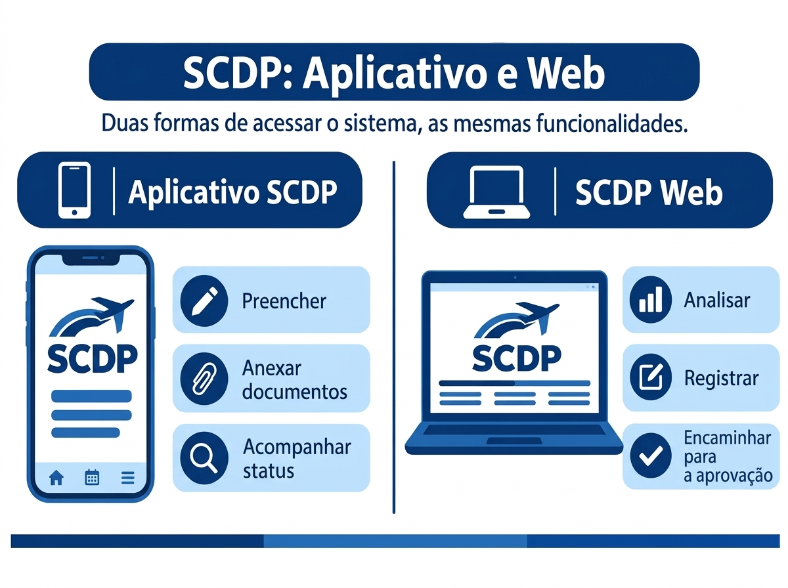

Tamanho do texto:

<button onclick="diminuirFonte()"
style="padding: 6px 12px; font-weight: bold; cursor: pointer; border: 1px solid #ccc; border-radius: 4px; background: #f8f9fa;">
A-
</button>

<button onclick="resetarFonte()"
style="padding: 6px 12px; font-weight: bold; cursor: pointer; border: 1px solid #ccc; border-radius: 4px; background: #f8f9fa;">
A
</button>

<button onclick="aumentarFonte()"
style="padding: 6px 12px; font-weight: bold; cursor: pointer; border: 1px solid #ccc; border-radius: 4px; background: #f8f9fa;">
A+
</button>

<button onclick="window.print()"
style="background-color: #0056b3; color: white; padding: 6px 16px; border: none; border-radius: 5px; font-size: 14px; cursor: pointer; box-shadow: 0 2px 4px rgba(0,0,0,0.2);">

🖨️ Imprimir ou baixar esta página

</button>

# 4. Aplicativo ou computador: qual usar?

  

Para fazer a prestação de contas pelo aplicativo SCDP. Preencha as informações solicitadas, anexe os documentos necessários, revise os dados e toque em **"Encaminhar"**.

!!! warning "Atenção"

    Se aparecer a mensagem **"Prestação de Contas iniciada pelo órgão que cadastrou a viagem"**, significa que o Solicitante de Viagem está conduzindo a prestação de contas no SCDP Web. Nesse caso, reúna os documentos necessários e encaminhe-os ao responsável pelo processo.

✅ **Ainda tem dúvida?**

Procure o Solicitante de Viagem responsável para confirmar se a prestação de contas será realizada pelo aplicativo ou pelo SCDP Web.

| Aspecto | Aplicativo SCDP | SCDP Web |
|----------|----------|----------|
| Quem realiza? | Proposto (viajante). | Solicitante de Viagem. |
| Quando utilizar? | Quando o botão **"Preencher"** estiver disponível. | Quando a prestação de contas for conduzida pelo órgão. |
| O que fazer? | Informar dados, anexar documentos, resolver pendências e acompanhar o processo. | Registrar, analisar, ajustar dados, anexar documentos e encaminhar para aprovação. |
| Acompanhamento | Situação exibida no aplicativo com notificações. | Realizado no SCDP Web até a aprovação final. |

---

<button onclick="window.print()"
style="background-color: #0056b3; color: white; padding: 6px 16px; border: none; border-radius: 5px; font-size: 14px; cursor: pointer; box-shadow: 0 2px 4px rgba(0,0,0,0.2);">

🖨️ Imprimir ou baixar esta página

</button>

---

<button onclick="window.print()"
style="background-color: #0056b3; color: white; padding: 6px 16px; border: none; border-radius: 5px; font-size: 14px; cursor: pointer; box-shadow: 0 2px 4px rgba(0,0,0,0.2);">

🖨️ Imprimir ou baixar esta página

</button>

