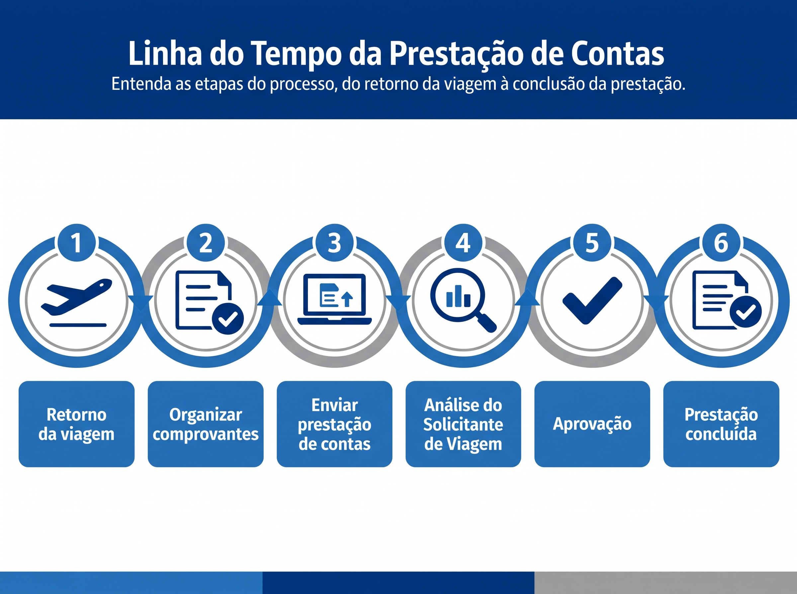
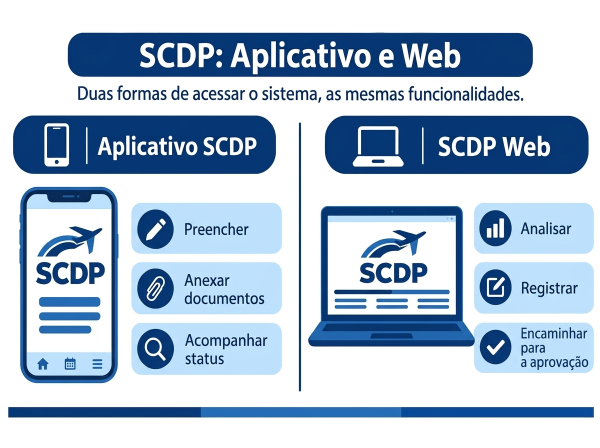
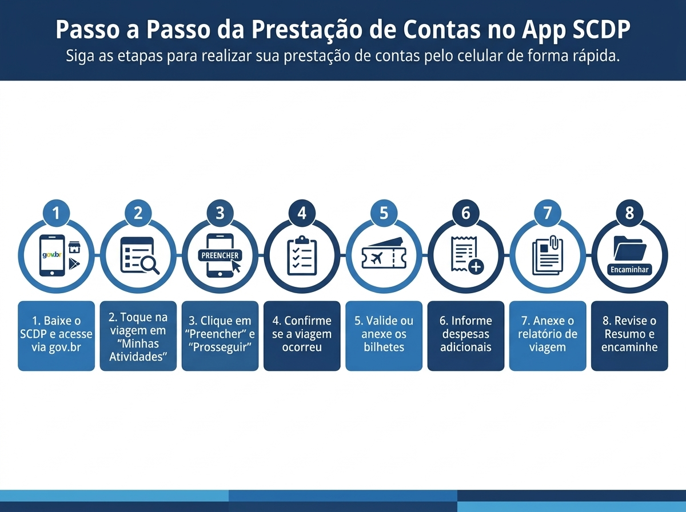

Tamanho do texto:

<button onclick="diminuirFonte()"
style="padding: 6px 12px; font-weight: bold; cursor: pointer; border: 1px solid #ccc; border-radius: 4px; background: #f8f9fa;">
A-
</button>

<button onclick="resetarFonte()"
style="padding: 6px 12px; font-weight: bold; cursor: pointer; border: 1px solid #ccc; border-radius: 4px; background: #f8f9fa;">
A
</button>

<button onclick="aumentarFonte()"
style="padding: 6px 12px; font-weight: bold; cursor: pointer; border: 1px solid #ccc; border-radius: 4px; background: #f8f9fa;">
A+
</button>

<button onclick="window.print()"
style="background-color: #0056b3; color: white; padding: 6px 16px; border: none; border-radius: 5px; font-size: 14px; cursor: pointer; box-shadow: 0 2px 4px rgba(0,0,0,0.2);">

🖨️ Imprimir ou baixar esta página

</button>

PÚBLICO-ALVO: SERVIDORES E AGENTES PÚBLICOS USUÁRIOS DO SERVIÇO DO SISTEMA DE CONCESSÃO DE DIÁRIAS E PASSAGENS. 

### Coleção de Boas Práticas para Melhoria da Experiência do Usuário    
### Guia 2           

# SISTEMA DE CONCESSÃO DE DIÁRIAS E PASSAGENS (SCDP)      

O Sistema de Concessão de Diárias e Passagens (SCDP) é a ferramenta do Governo Federal utilizada para solicitar, aprovar, registrar e prestar contas de viagens a serviço, tanto nacionais quanto internacionais. 

Esta cartilha orienta como prestar contas de uma viagem a serviço, tanto pelo aplicativo quanto pelo computador. Também apresenta as instruções para que o **Solicitante de Viagem** possa analisar e concluir o processo. Aqui, são apresentadas as **regras gerais** do SCDP. O seu órgão pode adotar normas internas complementares. 

Se houver alguma diferença entre as orientações desta cartilha e as normas do seu órgão, siga as orientações do **Solicitante de Viagem** ou do **Gestor Setorial do SCDP**. 

Mesmo quando não há pagamento de diárias, a viagem deve ser registrada no sistema e a prestação de contas continua sendo obrigatória.

Para encontrar a orientação desejada, localize sua situação na lista abaixo e consulte a seção indicada. 

## Formatos de Visualização

Você pode acessar as seções específicas utilizando o menu lateral ou navegar diretamente pelas páginas principais do manual.

* [1. O que é a prestação de contas? ](o-que-e-prestacao-contas.md)
* [2. Quem faz o que no processo?](papeis-e-responsabilidades.md)
* [3. Prazo e consequências](prazo-e-consequencias.md)
* [4. Aplicativo ou computador: qual usar?](aplicativo-ou-computador.md)
* [5. Passo a passo pelo aplicativo](passo-a-passo-aplicativo.md)
* [6. Passo a passo pelo computador](passo-a-passo-web.md)
* [7. Documentos e comprovação de bilhetes](documentos.md)
* [8. Minha prestação de contas voltou. E agora?](pendencias.md)
* [9. Exceções e devolução de valores](excecoes.md)
* [10. Como acompanhar: status e avisos](status-e-avisos.md)
* [11. Deu problema? Soluções rápidas](solucoes-rapidas.md)
* [12. Quando e como procurar a central](central-de-atendimento.md)
* [13. Listas de verificação por perfil](checklists.md)
* [14. Perguntas e respostas](perguntas-respostas.md)
* [15. Referências](referencias.md)
* [16. Guia Completo](cartilha-completa.md)

---

# 1. O que é a prestação de contas?
A prestação de contas é realizada no SCDP, mediante o registro das informações da viagem e o envio dos documentos que comprovam os deslocamentos e as atividades realizadas. Esse procedimento além de atender às exigências legais, contribui para a   transparência na aplicação dos recursos públicos, possibilita o acompanhamento pelos órgãos de controle e oferece maior segurança ao próprio viajante. 

A obrigatoriedade da prestação de contas está prevista na Constituição Federal (art. 70, parágrafo único), no Decreto nº 5.992/2006 e na Instrução Normativa SLTI/MP nº 3/2015, que determina sua realização no SCDP em até cinco dias após o retorno da viagem. 

  

As referências normativas citadas estão disponíveis ao final desta cartilha. 

---

# 2. Quem faz o que no processo? 

A prestação de contas envolve diferentes perfis no Sistema de Concessão de Diárias e Passagens (SCDP), cada um com responsabilidades específicas relacionadas ao registro, à análise e à aprovação das informações da viagem.

| Papel | O que faz na prestação de contas |
|---------|---------|
| **Proposto (quem viaja)** | Anexa os comprovantes no aplicativo. Caso não seja possível enviá-los por esse canal, encaminha a documentação ao Solicitante de Viagem, que registrará a prestação de contas no SCDP Web. Se houver valores a devolver, o pagamento deverá ser efetuado por meio de Guia de Recolhimento da União (GRU). |
| **Solicitante de Viagem** | Cadastra a viagem no SCDP Web e registra a prestação de contas com base nos documentos enviados pelo Proposto. Confere os dados e os anexos, realiza os ajustes necessários e encaminha a prestação de contas para aprovação. Emite a Guia de Recolhimento da União (GRU), quando houver valores a devolver. |
| **Aprovador da Prestação de Contas (Ação Administrativa Proponente ou autoridade responsável)** | Analisa a prestação de contas e decide por sua aprovação, encerrando a viagem no sistema, ou por sua devolução para correção, indicando as pendências identificadas. |
| **Gestor Setorial do SCDP** | Gerencia os usuários e os perfis de acesso do SCDP no órgão e orienta sobre procedimentos relacionados às normas internas. |
| **Central de Atendimento** | Orienta os usuários sobre a utilização do sistema, registra ocorrências e realiza os encaminhamentos necessários. |

!!! note "Nota"

    A Central de Atendimento não aprova prestações de contas, não altera registros e não realiza cadastros em nome dos usuários.

---

# 3. Prazo e consequências

O prazo máximo para que a prestação de contas seja registrada no SCDP é de até 5 dias, contados da data de retorno da viagem.

- **Viagens nacionais:** a prestação de contas e os respectivos comprovantes devem ser apresentados em até 5 dias após o retorno da viagem.
- **Viagens internacionais:** os cartões de embarque e desembarque devem ser apresentados em até 5 dias após o retorno. Nos casos de afastamento com ônus ou ônus limitado, o relatório circunstanciado deverá ser apresentado em até 30 dias após o término do afastamento do País.
- **Prestação de contas fora do prazo:** o atraso deverá ser justificado tanto no aplicativo quanto no SCDP Web.

## 3.1 Como o aplicativo mostra o prazo

O aplicativo apresenta a situação da prestação de contas da seguinte forma:

- **Em prestação de contas:** a viagem foi concluída e o prazo de 5 dias para a prestação de contas ainda está em andamento.
- **Prestação de contas pendente:** já se passaram mais de 5 dias da data de retorno da viagem.

O SCDP envia uma notificação no dia seguinte ao término da viagem.

Também é possível iniciar a prestação de contas antes da viagem, por exemplo, para informar que o afastamento não ocorreu.

## 3.2 O que acontece se eu não prestar contas?

| Situação | Consequência |
|-----------|-----------|
| **Prestação de contas pendente** | Novas viagens do mesmo Proposto poderão ser impedidas, conforme avaliação da autoridade competente. A autorização de uma nova viagem quando houver prestação de contas pendente constitui exceção e exige justificativa formal da autoridade responsável pela aprovação. |
| **Prestação de contas inadequada ou sem comprovação** | O Proposto deverá devolver os recursos ao Tesouro Nacional, observados os prazos e procedimentos previstos na legislação aplicável. |
| **Prestação de contas fora do prazo** | Será necessário apresentar justificativa para o atraso. A ocorrência permanecerá registrada no histórico da viagem para fins de controle, conferência e auditoria. |
| **Pendências de anos anteriores** | Permanecem sob responsabilidade do Proposto, mesmo que o aplicativo apresente apenas as viagens registradas na versão atual do SCDP (2014). Solicite ao Solicitante de Viagem ou ao Gestor Setorial a relação das viagens com prestação de contas pendente e providencie sua regularização. |
| **Pendência de prestação de contas em outro órgão de lotação** | O SCDP exibirá a informação de pendência, que deverá ser regularizada e aprovada pelo órgão em que foi originalmente gerada. |

!!! note "Nota"

    O prazo para prestação de contas é contado a partir da data de retorno da viagem. O descumprimento desse prazo poderá resultar em restrições para novas viagens e em outras consequências previstas na legislação e nos normativos aplicáveis.  

---

# 4. Aplicativo ou computador: qual usar?

  

Para fazer a prestação de contas pelo aplicativo SCDP. Preencha as informações solicitadas, anexe os documentos necessários, revise os dados e toque em **"Encaminhar"**.

!!! warning "Atenção"

    Se aparecer a mensagem **"Prestação de Contas iniciada pelo órgão que cadastrou a viagem"**, significa que o Solicitante de Viagem está conduzindo a prestação de contas no SCDP Web. Nesse caso, reúna os documentos necessários e encaminhe-os ao responsável pelo processo.

✅ **Ainda tem dúvida?**

Procure o Solicitante de Viagem responsável para confirmar se a prestação de contas será realizada pelo aplicativo ou pelo SCDP Web.

| Aspecto | Aplicativo SCDP | SCDP Web |
|----------|----------|----------|
| Quem realiza? | Proposto (viajante). | Solicitante de Viagem. |
| Quando utilizar? | Quando o botão **"Preencher"** estiver disponível. | Quando a prestação de contas for conduzida pelo órgão. |
| O que fazer? | Informar dados, anexar documentos, resolver pendências e acompanhar o processo. | Registrar, analisar, ajustar dados, anexar documentos e encaminhar para aprovação. |
| Acompanhamento | Situação exibida no aplicativo com notificações. | Realizado no SCDP Web até a aprovação final. |

---

<button onclick="window.print()"
style="background-color: #0056b3; color: white; padding: 6px 16px; border: none; border-radius: 5px; font-size: 14px; cursor: pointer; box-shadow: 0 2px 4px rgba(0,0,0,0.2);">

---

# 5. Passo a passo pelo aplicativo

  

1. Baixe o SCDP na Google Play ou na Aplicativo Store e entre com sua conta gov.br (Prata ou Ouro).

2. Em "Minhas Atividades” aparecem as viagens que exigem ação. Todas as viagens estão em “Minhas Viagens a Serviço” (use o filtro “Prestação pendente” ou “Prestação a vencer”). Toque no quadro com os dados da viagem.

3. Clique em **“Preencher”**.

4. Ao final de cada etapa, clique em **“Prosseguir”** para avançar. O botão fica disponível enquanto a prestação de contas estiver em um dos seguintes status:

   - Não iniciada
   - Em elaboração
   - Devolvida
   - Aguardando devolução de valores

5. **A viagem ocorreu?**

   A opção **“Sim”** já vem marcada. Se mudar para **“Não”**, informe o motivo e anexe o comprovante (por exemplo, atestado médico).

   **O roteiro ocorreu como cadastrado?**

   Se houve mudança de voo, data ou roteiro, explique no campo de justificativa.

6. **Comprovando cada trecho da viagem:**

   - **Comprovação automática:** Na modalidade Compra Direta, o SCDP confirmou com a companhia aérea o uso do bilhete. Você não precisa anexar o comprovante.
   - **Pendente:** toque no ícone do lápis, revise os dados, informe se houve alteração e anexe o comprovante de embarque.
   - **Inconsistência detectada:** a companhia informou o uso de um bilhete que estava inutilizado. Justifique.

7. **Inclua despesas adicionais, se houver:**

   Gastos realizados com autorização (por exemplo, bilhete de transporte não atendido pela agência contratada): informe valor, descreva a despesa e anexe o documento **“Comprovante de Gastos Autorizados”**.

8. **Anexe o relatório e outros documentos.**

   No aplicativo, o Relatório de Viagem é exigido nas viagens internacionais. Nas nacionais, confirme a exigência com seu órgão.

   O link **“Exemplo de Relatório”** oferece um modelo. Antes de usá-lo, confirme se seu órgão aceita esse modelo.

   Em **“Outros documentos”**: lista de presença, certificado, fotos do evento etc.

9. **Confira o Resumo e clique em “Encaminhar”.**

    

  

!!! warning "Antes de enviar, confira os arquivos"

    Depois que a prestação é encaminhada, os arquivos não podem mais ser removidos. Confira se anexou os documentos certos e se é possível ler todas as informações.

Se aparecer a mensagem **"O envio não pode ser realizado neste momento."**, aguarde alguns instantes e tente novamente.
    - Verifique se a viagem continua disponível para preenchimento.
    - Tente realizar o envio novamente mais tarde.
    - Se a mensagem continuar aparecendo, procure a Central de Atendimento e informe a mensagem exibida pelo sistema.

Antes de entrar em contato com a Central de Atendimento, tenha em mãos:
    - Número da PCDP;
    - Data e horário aproximados da ocorrência;
    - Mensagem apresentada pelo sistema;
    - Captura de tela sem dados pessoais expostos.

!!! warning "Atenção"

    Guarde o protocolo gerado, pois ele comprova o envio dos documentos.

## Resultado esperado
Depois do envio, a situação muda para **“Encaminhada”**. O Solicitante analisa a prestação de contas e a autoridade decide sobre a aprovação. Após a aprovação, o processo é encerrado e você recebe uma notificação.

---

# 6. Passo a passo pelo computador (SCDP Web)

**Assuntos relacionados:** Documentos e bilhetes | Devolução de valores

1. **Proposto:** reúna os comprovantes, assine o relatório e entregue tudo ao Solicitante de Viagem.
2. **Solicitante:** SCDP Web › Prestação de Contas › selecione a viagem › confirme, anexe e encaminhe para aprovação.

## O que o Proposto faz

1. Junta cartões de embarque, bilhetes ou recibos de check-in, certificados ou listas de presença e assina o Relatório de Viagem.
2. Entrega tudo ao Solicitante de Viagem, nos primeiros dias após o retorno.
3. Acompanha o andamento e responde rapidamente se o Solicitante pedir correção.

## O que o Solicitante faz no SCDP Web

1. **Abra a prestação de contas:** Acesse o SCDP pelo gov.br, vá em Prestação de Contas e selecione a viagem (PCDP) na lista.
2. **Confirme a viagem:** Responda se a viagem foi ou não realizada e, se necessário, ajuste os trechos e os bilhetes para mostrar como a viagem aconteceu. O sistema recalcula os valores automaticamente e indica o valor a devolver, quando houver.
3. **Confira a comprovação dos bilhetes:** Se o SCDP comprovar automaticamente o uso do bilhete, você não precisa anexar o comprovante. Na Compra Direta, se o sistema não confirmar o uso com a Companhia Aérea, anexe os comprovantes de embarque entregues pelo Viajante. No agenciamento, é obrigatório anexar os comprovantes dos bilhetes.
4. **Anexe os documentos:** Anexe o Relatório de Viagem (tipo de documento “Relatório de Viagem”) e os demais comprovantes. Se houver devolução, anexe também a GRU e o comprovante de pagamento. Para que o Viajante veja o arquivo no aplicativo, marque “Visível no aplicativo”.
5. **Encaminhe:** Encaminhe a prestação ao aprovador. Se houver valor a devolver, siga para Prestação de Contas › Devolução de Valores. Se estiver fora do prazo, registre a justificativa.
6. **Acompanhe até a conclusão:** Confira a decisão do aprovador. Se for devolvida, ajuste e envie novamente. A prestação só está concluída quando aprovada.

## Se a prestação foi iniciada pelo aplicativo

O Solicitante analisa o que o Proposto enviou: confirma o início da análise no SCDP Web e, se houver divergência, devolve com o texto da correção. Isso aparece como pendência no aplicativo do Proposto.

## Alterei a viagem depois de iniciar?

Se precisar alterar a PCDP depois de iniciar a prestação de contas, o Solicitante de Viagem deve: desfazer a prestação em andamento, alterar a PCDP e iniciar novamente a prestação de contas. Depois, deve encaminhá-la.

---

# 7. Documentos e comprovação de bilhetes

| DOCUMENTO | QUANDO É NECESSÁRIO | ORIENTAÇÃO |
|------------|------------|------------|
| Comprovante de embarque (cartão ou canhoto, bilhete ou recibo de check-in) | Quando houve deslocamento com passagem e o SCDP não comprovou automaticamente o uso do bilhete. | Guarde durante a viagem. Digitalize em arquivo legível, com ida e volta. |
| Declaração da empresa de transporte | Quando não for possível apresentar o cartão de embarque. | Peça à empresa uma declaração que confirme que você fez a viagem. |
| Relatório de Viagem | SCDP Web: na prestação de contas. Aplicativo: obrigatório em viagens internacionais; nas nacionais, conforme definido pelo órgão. | Descreva as atividades. Use o modelo do órgão ou o “Exemplo de Relatório” do aplicativo. |
| Comprovante de participação (certificado, declaração, lista de presença) | Quando a viagem for para evento, curso ou reunião e o órgão exigir. | Peça ao organizador ao final do evento. |
| Comprovante de Gastos Autorizados | Quando houve despesa autorizada a indenizar ou restituir. | Anexo obrigatório para cada despesa informada. |
| Comprovante do motivo da não realização | Quando a viagem não ocorreu. | Por exemplo, atestado médico. |
| Justificativa de atraso | Quando o envio ocorre após 5 dias do retorno. | Exigida pelo sistema. Seja objetivo. |
| GRU e comprovante de pagamento | Quando há valor a devolver. | Veja a seção 9. |

## Facilite sua prestação de contas

- Antes de viajar: salve bilhetes e cartões de embarque no celular e fotografe os canhotos físicos.
- Na volta: envie PDF ou imagem legível, com nomes claros (ex.: cartao_embarque_ida.pdf).

## Atenção

As regras internas do seu órgão podem exigir outros documentos. Confirme a lista com o Solicitante de Viagem antes de entregar. Como boa prática administrativa também recomenda-se incluir convites, programações, certificados ou folders.

## Problemas com o comprovante

| SITUAÇÃO | O QUE FAZER |
|-----------|-----------|
| Perdi o cartão de embarque | Apresente o recibo de check-in feito pela internet ou peça à empresa de transporte uma declaração que confirme a viagem. |
| O bilhete aparece como “Pendente” | Toque no lápis ao lado do trecho, revise os dados e anexe o comprovante do tipo “Comprovação de embarque”. Se o bilhete foi alterado, informe e anexe o documento que comprove a alteração. |
| Apareceu “Inconsistência detectada” | A companhia informou o uso de um bilhete inutilizado. Justifique o caso na própria tela. |
| O arquivo foi rejeitado | Confira o formato e o tamanho aceitos na tela em que você anexa o arquivo. Se preciso, converta para PDF ou reduza a imagem. |
| O documento está ilegível | Faça uma nova digitalização ou tire outra foto, de modo que todas as informações fiquem legíveis. |

---

# 8. Minha prestação de contas voltou. E agora?

**Assuntos relacionados:** Como a prestação é feita | Quando procurar a Central

Não reinicie o processo. Abra a pendência, leia o que precisa corrigir, faça apenas os ajustes pedidos e envie novamente.

## Pelo aplicativo

1. **Abra a pendência:** O aplicativo avisa por notificação e mostra o alerta no menu Pendências. Toque em Resolver.
2. **Leia o pedido de correção:** O texto fica abaixo do número do protocolo. Atenção: ao tocar em Resolver, todo o formulário é reaberto. Ajuste apenas os pontos solicitados.
3. **Corrija e envie novamente:** Substitua o documento, complete o relatório ou ajuste a informação e toque em Encaminhar. Um novo protocolo é gerado e o status volta a Encaminhada.
4. **Acompanhe:** Pendências resolvidas ficam sombreadas no menu, com data e hora da resolução.

## Pelo SCDP Web (Solicitante é o responsável pelo registro)

1. O Solicitante de Viagem informa o que precisa ser corrigido. O Viajante entrega um documento legível ou completa o relatório e o envia ao Solicitante.
2. O Solicitante ajusta a prestação de contas no sistema e a envia novamente ao aprovador.

## Pendência de devolução de valores

Quando uma alteração na viagem gera valor a devolver (por exemplo, retorno antecipado), o protocolo vem identificado como “com valores a devolver”. Toque em Resolver, pague as guias disponíveis, anexe o comprovante do tipo “Comprovante de pagamento de guia” e toque em Enviar. O aplicativo gera um protocolo iniciado por DEV.

## Para Solicitantes e Aprovadores

Ao devolver uma prestação, escreva o motivo da devolução de forma clara e completa: diga qual item corrigir e como. Orientações vagas podem fazer a prestação voltar mais vezes e atrasar a conclusão.

---

# 9. Exceções e devolução de valores:  

Assuntos relacionados: Prazo e consequências | Quando procurar a Central 

**A viagem não aconteceu** 

Avise imediatamente o Solicitante de Viagem. No aplicativo, em Preencher, responda à pergunta “A viagem ocorreu? Não”, informe o motivo e anexe o comprovante, se houver. 

Diárias e passagens recebidas devem ser devolvidas por GRU no prazo de 5 dias. 

**Voltei antes ou depois do previsto** 

Informe o Solicitante de Viagem. A prestação deve refletir as datas e os trechos que você realmente fez e o sistema pode gerar valor a devolver ou a complementar. 

**Mudou trecho, voo ou horário** 

Guarde os comprovantes dos trechos realizados. No aplicativo, justifique em “O roteiro ocorreu como cadastrado?” e no bilhete alterado. No SCDP Web, o Solicitante de Viagem ajusta conforme o procedimento do órgão. 

**Não recebi diárias, só passagens** 

Entre em contato com o Coordenador Financeiro da Instituição responsável pelo afastamento. A prestação de contas continua necessária: o afastamento é registrado no SCDP mesmo sem pagamento de diárias. 

**A viagem foi cancelada pelo órgão** 

Se houve pagamento das diárias, o aplicativo mostra “Viagem não realizada” e não há prestação de contas a registrar. Se houve valor recebido, ele deve ser devolvido por GRU. 

### Devolução de valores: guia, pagamento e comprovação   

**1. Identificação do valor (a devolver)**  

O SCDP indica os valores de diárias, restituição, indenização e outras despesas a devolver. No aplicativo, aparece a pendência “com valores a devolver”. 

**2. Emissão da guia** 

No SCDP Web, o Solicitante acessa “Prestação de Contas › Devolução de Valores”. Depois, preenche os dados exigidos no Portal do Tesouro Nacional, emite a GRU e a envia ao viajante para pagamento. 

**3. Pagamento** 

O Proposto paga a GRU e anexa o comprovante pelo aplicativo ou envia ao Solicitante de Viagem. 

**4. Anexação** 

No aplicativo: Pendências › Resolver, anexe o “Comprovante de pagamento de guia” e toque em Enviar (protocolo DEV). No SCDP Web: o Solicitante anexa a GRU e o comprovante com o tipo de documento correspondente. 

**5. Conclusão** 

Pagar a guia não basta para concluir a prestação de contas. Acompanhe o processo até a aprovação. 

!!! warning "Atenção" 

    Quando a viagem não ocorrer ou houver saldo de diárias a devolver, observe o prazo aplicável e a orientação do órgão. Não espere o     fim do prazo para emitir e pagar a guia. 

    ---

# 10. Como acompanhar: status e avisos

No aplicativo, o status aparece na parte de baixo do quadro com os dados da viagem. Veja abaixo o que cada situação significa e o que fazer.

## Status da prestação de contas

| STATUS | O QUE SIGNIFICA | O QUE FAZER |
|---------|---------|---------|
| Não iniciada | Você ainda não começou o preenchimento. | Toque em Preencher. |
| Em elaboração | Você iniciou, ou a prestação foi devolvida para complementar ou ajustar. | Conclua e Encaminhe. |
| Encaminhada | Enviada após o 1º preenchimento, a complementação ou o comprovante de GRU. | Aguarde. Guarde o protocolo. |
| Em análise | O Solicitante iniciou a análise no SCDP Web. | Aguarde a decisão. |
| Devolvida | O Solicitante devolveu com pendência de preenchimento. | Abra Pendências e Resolva. |
| Aguardando devolução de valores | Há guia(s) disponibilizada(s) para você pagar. | Pague, anexe o comprovante e envie. |
| Aguardando complementação de valores | Após a análise, há valor adicional a ser pago a você. | Acompanhe o pagamento. |
| Concluída | Prestação analisada e aprovada pela autoridade. Viagem encerrada. | Guarde o resumo e o protocolo. |

## Status da viagem que exigem atenção

| STATUS DA VIAGEM | O QUE SIGNIFICA |
|---------|---------|
| Em prestação de contas | A viagem terminou e você está dentro dos 5 dias para prestar contas. |
| Prestação de contas pendente | Passaram-se mais de 5 dias do retorno. Regularize já. |
| Devolução de valores | Há valores a devolver antes do encerramento. |
| Viagem encerrada | Viagem e prestação de contas finalizadas (aprovadas ou não aprovadas). |
| Viagem não realizada | Viagem cancelada ou não realizada: não há prestação de contas a registrar. |

## Notificações do aplicativo

O aplicativo envia seis avisos:

1. prepare-se para a viagem (véspera);
2. prestação de contas (dia seguinte ao fim da viagem);
3. aprovação de complementação de valores;
4. pendência de devolução de valores;
5. pendência na prestação de contas; e
6. conclusão da prestação de contas.

Para receber no celular, ative as notificações nas configurações do aparelho e no aplicativo.

---

# 11. Deu problema? Soluções rápidas

| O QUE ACONTECE | CAUSA PROVÁVEL | O QUE FAZER |
|----------|----------|----------|
| Não vejo minha viagem no aplicativo | A viagem ainda não passou pela aprovação administrativa, ou é de ano anterior à versão atual do SCDP (2014). | Confirme com o Solicitante de Viagem o andamento. Para viagens antigas, peça a relação de pendências ao Solicitante de Viagem ou ao Gestor Setorial. |
| Não consigo entrar no aplicativo | O aplicativo exige CPF e conta gov.br Prata ou Ouro. | Altere sua conta gov.br para o nível Prata ou Ouro. Dúvidas da conta gov.br são atendidas pelo suporte do gov.br, não pela Central do SCDP. |
| Aparece “Prestação de Contas iniciada pelo órgão que cadastrou a viagem” | O Solicitante já iniciou a prestação no SCDP Web. | Entregue os documentos ao Solicitante. Ou, se preferir, anexe pelo aplicativo. |
| O botão “Preencher” sumiu | O botão só fica ativo quando a prestação não foi iniciada, está em elaboração, devolvida ou aguardando devolução de valores. | Veja o status no card. Se está Encaminhada ou Em análise, aguarde. |
| “O envio não pode ser realizado naquele momento” | O sistema está impedindo o envio por um período. | Aguarde e tente novamente mais tarde. Se o problema continuar, procure a Central de Atendimento. |
| Bilhete “Pendente” ou “Inconsistência detectada” | O SCDP não confirmou o uso, ou a companhia aérea informou uso de bilhete inutilizado. | Anexe o comprovante de embarque e justifique (seção 7). |
| Não consigo remover um arquivo | Após a aprovação, os arquivos não podem ser removidos. | Anexe o documento correto e explique a troca na justificativa ao Solicitante de Viagem. |
| Anexei no SCDP Web e não aparece no aplicativo | A opção “Visível no aplicativo” não foi marcada. | Peça ao Solicitante que anexe novamente com a opção marcada. |
| Não recebi as notificações | Notificações desabilitadas no aparelho ou no aplicativo. | Habilite nos dois: no celular e em Configurações do aplicativo. |
| Preciso de perfil de Solicitante ou acesso ao SCDP Web | Perfis são concedidos pelo Gestor Setorial do órgão. | Procure o Gestor Setorial do SCDP do seu órgão. |
| Há uma pendência de prestação de contas em uma unidade administrativa diferente do meu órgão de lotação | Não foi realizada a aprovação pela autoridade competente. | A pendência pode ser consultada por meio do aplicativo. Se necessário, solicite à Central de Atendimento o contato do responsável no órgão onde ela se encontra. |

## Erros mais comuns e como evitá-los

| ERRO FREQUENTE | COMO EVITAR |
|----------|----------|
| Deixar a prestação para o último dia (ou depois do prazo) | Preste contas nos primeiros dias após o retorno. O aplicativo avisa no dia seguinte ao fim da viagem. |
| Enviar cartão de embarque ilegível ou incompleto | Digitalize com boa qualidade e confira ida e volta antes de enviar. |
| Considerar que, sem diárias, não é preciso prestar contas | Preste contas de todo afastamento registrado no SCDP. |
| Não avisar que a viagem foi cancelada | Avise o Solicitante de Viagem imediatamente e providencie a GRU. |
| Corrigir uma pendência refazendo tudo | Leia o pedido de correção e ajuste apenas o que foi pedido. |

---

# 12. Quando e como procurar a Central

## Quem pode ajudar em cada situação

| SUA DÚVIDA | PROCURE |
|------------|----------|
| Prazo interno, modelo de relatório, documentos exigidos, aprovação, pendências antigas | Solicitante de Viagem ou Gestor Setorial do seu órgão |
| Erro no sistema, mensagem inesperada, tela que não carrega, bilhete com informação diferente da registrada no sistema | Central de Atendimento |
| Como usar uma funcionalidade do SCDP ou do aplicativo | Manuais e tutoriais do SCDP e, se persistir, Central de Atendimento |
| Conta ou nível gov.br | Suporte do gov.br (a Central do SCDP não atende a conta gov.br) |

## Canais da Central de Atendimento do MGI

**Telefone:** 0800 978 9001, opção 2 – SCDP.

**Portal de Serviços:** portaldeservicos.gestao.gov.br. Abra o chamado pelo computador ou celular e acompanhe o atendimento no próprio portal ou pelas notificações enviadas ao seu e-mail.

## Antes de pedir ajuda, reúna estas informações

1. Número da PCDP e nome do órgão.
2. Se o problema é no aplicativo ou no SCDP Web e em qual etapa (preencher, anexar, encaminhar, resolver pendência).
3. A situação da viagem ou da prestação de contas que aparece tela.
4. Mensagem de erro copiada exatamente como apresentada.
5. Data e horário aproximados e o que você já tentou fazer.
6. Captura de tela sem dados pessoais ou bancários expostos.

## Segurança

Nunca envie senha, código de autenticação ou dados bancários completos ao atendimento, por e-mail, chamado, telefone ou mensagem. A Central não pede essas informações.

## O que a Central não faz

A Central não aprova nem registra prestação de contas em nome do usuário. Também não altera os dados da viagem. As decisões sobre exceções de prazo cabem ao órgão.

---

# 13. Listas de verificação por perfil  

### Proposto (viajante)  

☐ guardar bilhetes e cartões de embarque de ida e volta;  

☐ conferir se minha viagem aparece no aplicativo e qual é o status;  

☐ preencher a prestação no aplicativo (ou entreguei os documentos ao Solicitante) em até 5 dias do retorno;  

☐ anexar o relatório (quando exigido) e os comprovantes legíveis;  

☐ guardar o protocolo de envio;  

☐ acompanhar as notificações e resolvi as pendências, inclusive o pagamento da GRU, se houve.  

### Solicitante de Viagem  

☐ conferir se a prestação foi iniciada pelo Proposto (aplicativo) ou se devo registrá-la no SCDP Web;  

☐ verificar se os documentos estão legíveis e assinados e se as informações do relatório, dos comprovantes e dos trechos são compatíveis;  

☐ ajustar trechos e bilhetes à situação real e anexei os documentos (com “Visível no aplicativo” quando couber);  

☐ devolver com apontamento claro quando faltou algo;  

☐ emitir a GRU e informei o Proposto quando havia valor a devolver;  

☐ encaminhar ao aprovador dentro do prazo.  

### Aprovador  

☐ verificar a coerência entre relatório, comprovantes e dados da PCDP;  

☐ registrar com clareza o que precisava ser corrigido quando devolvi a prestação;  

☐ decidir a aprovação sem deixar a prestação de contas parada.  

---

# 14. Perguntas e respostas:  

**1. Quanto tempo tenho para prestar contas?**  
Até 5 dias, contados do retorno da viagem.

**2. Posso prestar contas pelo celular?**  
Sim, pelo aplicativo SCDP, com conta gov.br Prata ou Ouro, se a prestação não foi iniciada pelo órgão no SCDP Web.

**3. Quem registra a prestação no SCDP Web?**  
O Solicitante de Viagem, com os documentos entregues pelo viajante.

**4. Preciso prestar contas se não recebi diárias?**  
Sim. O afastamento é registrado e comprovado no SCDP mesmo sem pagamento de diárias.

**5. Perdi o cartão de embarque. E agora?**  
Use o recibo de check-in ou peça à empresa de transporte uma declaração que comprove a viagem.

**6. Minha prestação voltou. Começo de novo?**  
Não. Abra a pendência, corrija o que foi apontado e envie novamente.

**7. Como sei que a documentação foi recebida?**  
O aplicativo gera um protocolo com data e hora, guardado em Resumo.

**8. A viagem foi cancelada. Preciso fazer algo?**  
Sim. Avise o Solicitante de Viagem e providencie a devolução dos valores por GRU, se houver.

**9. A Central de Atendimento aprova minha prestação de contas?**  
Não. A aprovação cabe ao aprovador definido no fluxo do seu órgão.

# 16. Referências

- BRASIL. Constituição da República Federativa do Brasil de 1988. Art. 70, parágrafo único.

- BRASIL. Decreto nº 5.992, de 19 de dezembro de 2006. Dispõe sobre a concessão de diárias no âmbito da administração federal direta, autárquica e fundacional.

- BRASIL. Decreto nº 6.258, de 19 de novembro de 2007. Altera o Decreto nº 5.992/2006, para dispor sobre o uso obrigatório do SCDP.

- BRASIL. Decreto nº 91.800, de 18 de outubro de 1985. Dispõe sobre viagens ao exterior e estabelece, no art. 16, relatório circunstanciado em 30 dias para viagens com ônus ou ônus limitado.

- BRASIL. Ministério do Planejamento, Orçamento e Gestão. Instrução Normativa SLTI/MP nº 3, de 11 de fevereiro de 2015. Dispõe sobre diretrizes e procedimentos para a concessão de diárias e passagens. Art. 19.

- BRASIL. Lei nº 8.429, de 2 de junho de 1992. Art. 11, VI (deixar de prestar contas quando esteja obrigado a fazê-lo).

- BRASIL. Ministério da Gestão e da Inovação em Serviços Públicos. Tutorial do Aplicativo do SCDP: visão do Proposto. Versão 1.0, jul. 2025. Portal de Compras do Governo Federal.

- BRASIL. Ministério da Gestão e da Inovação em Serviços Públicos. Manuais operacionais do SCDP (Solicitante de Viagem, Tutorial SCDP Web e Aplicativo). Disponível em: <a href="https://www.gov.br/compras/pt-br/acesso-a-informacao/manuais/manuais-scdp" target="_blank" rel="noopener noreferrer">https://www.gov.br/compras/pt-br/acesso-a-informacao/manuais/manuais-scdp</a>.

- BRASIL. Ministério da Gestão e da Inovação em Serviços Públicos. Central de Atendimento. Disponível em: <a href="https://www.gov.br/gestao/pt-br/assuntos/gestaoeinovacao/central-de-atendimento" target="_blank" rel="noopener noreferrer">https://www.gov.br/gestao/pt-br/assuntos/gestaoeinovacao/central-de-atendimento</a>.

---

<button onclick="window.print()"
style="background-color: #0056b3; color: white; padding: 6px 16px; border: none; border-radius: 5px; font-size: 14px; cursor: pointer; box-shadow: 0 2px 4px rgba(0,0,0,0.2);">

🖨️ Imprimir ou baixar esta página

</button>

