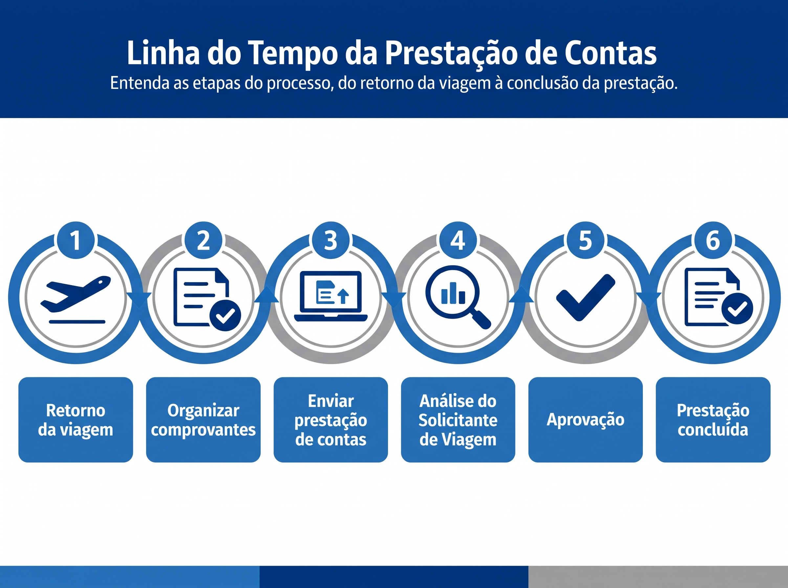

Tamanho do texto:

<button onclick="diminuirFonte()"
style="padding: 6px 12px; font-weight: bold; cursor: pointer; border: 1px solid #ccc; border-radius: 4px; background: #f8f9fa;">
A-
</button>

<button onclick="resetarFonte()"
style="padding: 6px 12px; font-weight: bold; cursor: pointer; border: 1px solid #ccc; border-radius: 4px; background: #f8f9fa;">
A
</button>

<button onclick="aumentarFonte()"
style="padding: 6px 12px; font-weight: bold; cursor: pointer; border: 1px solid #ccc; border-radius: 4px; background: #f8f9fa;">
A+
</button>

<button onclick="window.print()"
style="background-color: #0056b3; color: white; padding: 6px 16px; border: none; border-radius: 5px; font-size: 14px; cursor: pointer; box-shadow: 0 2px 4px rgba(0,0,0,0.2);">
🖨️ Imprimir ou baixar esta página
</button>

# 1. O que é a prestação de contas?

A prestação de contas é realizada no SCDP, mediante o registro das informações da viagem e o envio dos documentos que comprovam os deslocamentos e as atividades realizadas. Esse procedimento além de atender às exigências legais, contribui para a transparência na aplicação dos recursos públicos, possibilita o acompanhamento pelos órgãos de controle e oferece maior segurança ao próprio viajante.

A obrigatoriedade da prestação de contas está prevista na Constituição Federal (art. 70, parágrafo único), no [Decreto nº 5.992, de 2006](https://www.planalto.gov.br/ccivil_03/_ato2004-2006/2006/decreto/d5992.htm) e na [Instrução Normativa SLTI/MP nº 3, de 2015](https://www.gov.br/compras/pt-br/acesso-a-informacao/legislacao/instrucoes-normativas/instrucao-normativa-no-3-de-11-de-fevereiro-de-2015), que estabelece a realização da prestação de contas no SCDP no prazo de até cinco dias após o retorno da viagem.

As referências normativas citadas estão disponíveis ao final desta cartilha.

---

<button onclick="window.print()"
style="background-color: #0056b3; color: white; padding: 6px 16px; border: none; border-radius: 5px; font-size: 14px; cursor: pointer; box-shadow: 0 2px 4px rgba(0,0,0,0.2);">
🖨️ Imprimir ou baixar esta página
</button>

