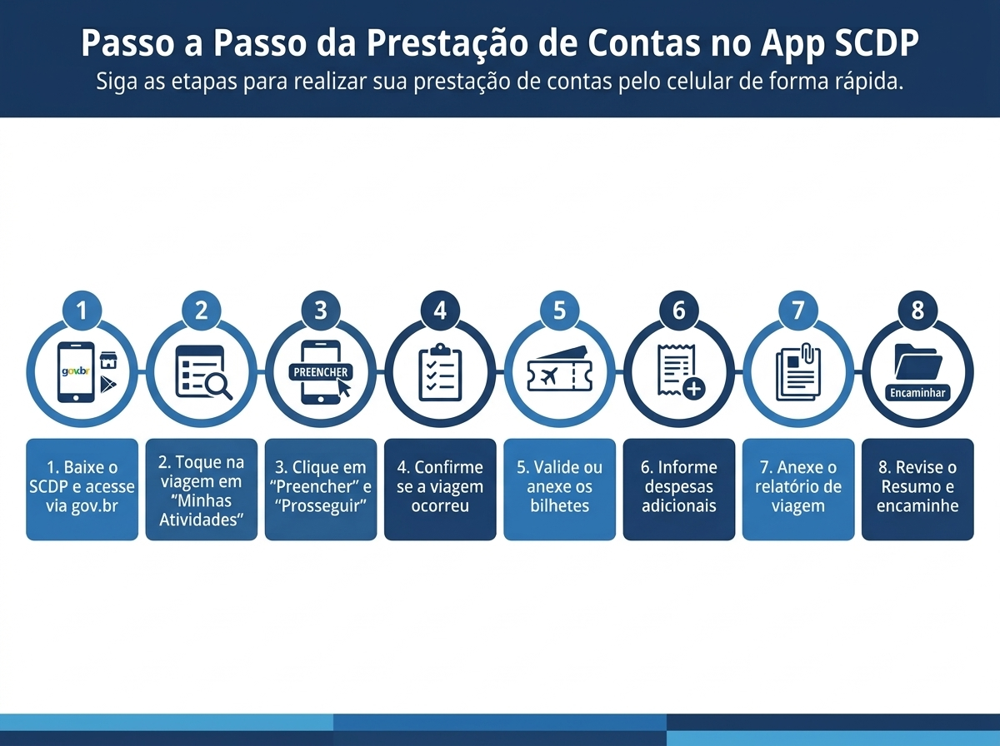

Tamanho do texto:

<button onclick="diminuirFonte()"
style="padding: 6px 12px; font-weight: bold; cursor: pointer; border: 1px solid #ccc; border-radius: 4px; background: #f8f9fa;">
A-
</button>

<button onclick="resetarFonte()"
style="padding: 6px 12px; font-weight: bold; cursor: pointer; border: 1px solid #ccc; border-radius: 4px; background: #f8f9fa;">
A
</button>

<button onclick="aumentarFonte()"
style="padding: 6px 12px; font-weight: bold; cursor: pointer; border: 1px solid #ccc; border-radius: 4px; background: #f8f9fa;">
A+
</button>

<button onclick="window.print()"
style="background-color: #0056b3; color: white; padding: 6px 16px; border: none; border-radius: 5px; font-size: 14px; cursor: pointer; box-shadow: 0 2px 4px rgba(0,0,0,0.2);">

🖨️ Imprimir ou baixar esta página

</button>

# 5. Passo a passo pelo aplicativo

### 1. Baixe o SCDP na Google Play ou na Aplicativo Store e entre com sua conta gov.br (Prata ou Ouro).

### 2. Em "Minhas Atividades” aparecem as viagens que exigem ação.

Todas as viagens estão em “Minhas Viagens a Serviço” (use o filtro “Prestação pendente” ou “Prestação a vencer”). Toque no quadro com os dados da viagem.

### 3. Clique em “Preencher”.

### 4. Ao final de cada etapa, clique em “Prosseguir” para avançar.

O botão fica disponível enquanto a prestação de contas estiver em um dos seguintes status:

- Não iniciada
- Em elaboração
- Devolvida
- Aguardando devolução de valores

### 5. A viagem ocorreu?

- A opção **“Sim”** já vem marcada.
- Se mudar para **“Não”**, informe o motivo e anexe o comprovante (por exemplo, atestado médico).

**O roteiro ocorreu como cadastrado?**

Se houve mudança de voo, data ou roteiro, explique no campo de justificativa.

### 6. Comprovando cada trecho da viagem

- **Comprovação automática:** Na modalidade Compra Direta, o SCDP confirmou com a companhia aérea o uso do bilhete. Você não precisa anexar o comprovante.

- **Pendente:** toque no ícone do lápis, revise os dados, informe se houve alteração e anexe o comprovante de embarque.

- **Inconsistência detectada:** a companhia informou o uso de um bilhete que estava inutilizado. Justifique.

### 7. Inclua despesas adicionais, se houver

Gastos realizados com autorização (por exemplo, bilhete de transporte não atendido pela agência contratada): informe valor, descreva a despesa e anexe o documento **“Comprovante de Gastos Autorizados”**.

### 8. Anexe o relatório e outros documentos

No aplicativo, o Relatório de Viagem é exigido nas viagens internacionais. Nas nacionais, confirme a exigência com seu órgão.

O link **“Exemplo de Relatório”** oferece um modelo. Antes de usá-lo, confirme se seu órgão aceita esse modelo.

Em **“Outros documentos”**: lista de presença, certificado, fotos do evento etc.

### 9. Confira o Resumo e clique em “Encaminhar”

**Antes de enviar, confira os arquivos**

Depois que a prestação é encaminhada, os arquivos não podem mais ser removidos. Confira se anexou os documentos certos e se é possível ler todas as informações.

!!! warning "Atenção!"

    Se o envio estiver bloqueado e aparecer a mensagem **“O envio não pode ser realizado neste momento.”**, aguarde alguns instantes e tente novamente.

    - Verifique se a viagem continua disponível para preenchimento.
    - Tente realizar o envio novamente mais tarde.
    - Se a mensagem continuar aparecendo, procure a Central de Atendimento e informe a mensagem exibida pelo sistema.

Antes de entrar em contato com a Central de Atendimento, tenha em mãos:

    - Número da PCDP;
    - Data e horário aproximados da ocorrência;
    - Mensagem apresentada pelo sistema;
    - Captura de tela sem dados pessoais expostos.
    

!!! warning "Atenção"

    Guarde o protocolo gerado, pois ele comprova o envio dos documentos.

### Resultado esperado

Depois do envio, a situação muda para **“Encaminhada”**. O Solicitante analisa a prestação de contas e a autoridade decide sobre a aprovação. Após a aprovação, o processo é encerrado e você recebe uma notificação.

!!! warning "Atenção"

    Guarde o protocolo gerado, pois ele comprova o envio dos documentos.

## Resultado esperado
Depois do envio, a situação muda para **“Encaminhada”**. O Solicitante analisa a prestação de contas e a autoridade decide sobre a aprovação. Após a aprovação, o processo é encerrcebe uma notificação.

<button onclick="window.print()"
style="background-color: #0056b3; color: white; padding: 6px 16px; border: none; border-radius: 5px; font-size: 14px; cursor: pointer; box-shadow: 0 2px 4px rgba(0,0,0,0.2);">

🖨️ Imprimir ou baixar esta página

</button>

